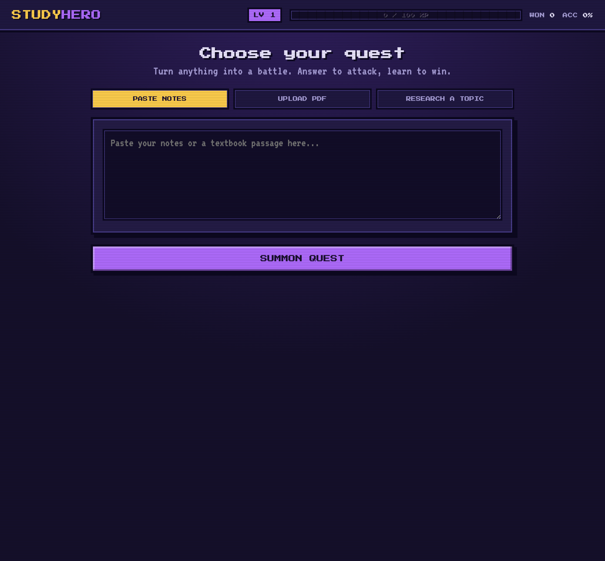
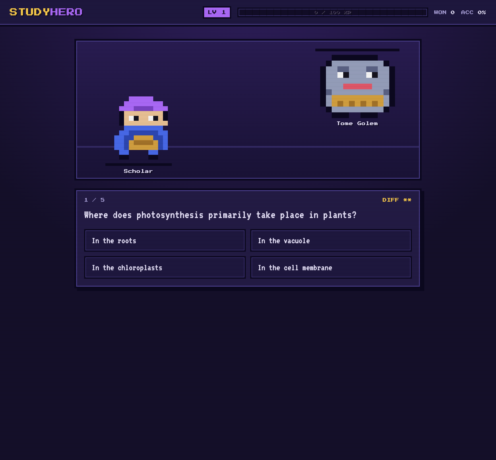
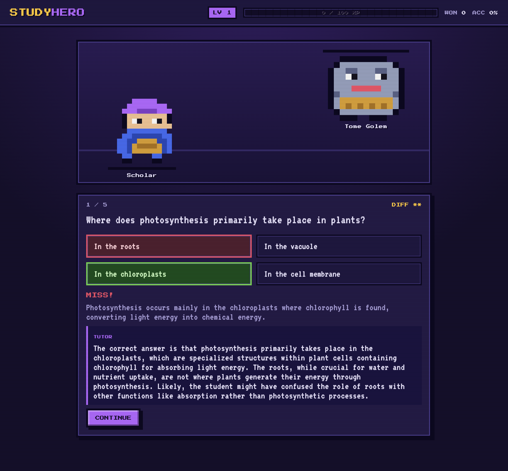

# Study Hero

A small study RPG. Turn your notes, a PDF, or just a topic into a quest of quiz
questions, then battle through them: right answers hit the monster and earn XP,
wrong answers cost HP and summon an AI tutor to explain what you missed.

It runs locally against a local LLM (Ollama by default), so your material and your
progress stay on your own machine.



## How it works

- **Three ways to start a quest**
  - Paste notes or a passage
  - Upload a PDF
  - Research a topic with no notes: it searches the web, reads a few sources, and
    synthesizes a study brief, falling back to the model's own knowledge if offline
- **Battle**: every question is a turn. Correct answers damage the monster and earn
  XP scaled by difficulty; wrong answers cost HP.
- **AI tutor**: miss a question and the tutor explains why the right answer is right
  and what the likely misunderstanding was.
- **Progress**: XP, levels, and accuracy carry over between sessions.





## Running it

Study Hero talks to a local LLM through [Ollama](https://ollama.com).

```bash
# 1. install Ollama, then pull a small instruct model
ollama pull qwen2.5:3b

# 2. set up Python
python3 -m venv .venv
source .venv/bin/activate
pip install -r requirements.txt

# 3. run it
python app.py
```

Then open http://localhost:5001.

### Configuration (optional)

Everything is set through environment variables:

- `OLLAMA_MODEL` (default `qwen2.5:3b`) and `OLLAMA_BASE_URL` (default `http://localhost:11434`)
- To use an OpenAI-compatible API instead: set `LLM_PROVIDER=openai`, plus `OPENAI_API_KEY`,
  `OPENAI_MODEL`, and `OPENAI_BASE_URL`.

## Project layout

```
app.py        # Flask app, quest creation, and the battle/answer API
ai.py         # question generation, tutor, research synthesis (LLM)
research.py   # web search and page fetch for the topic mode
game.py       # leveling curve and battle math
store.py      # player progress (JSON)
pdf_utils.py  # PDF text extraction
templates/    # the single page
static/       # pixel-art styling and the game loop
```

## License

[MIT](LICENSE)
